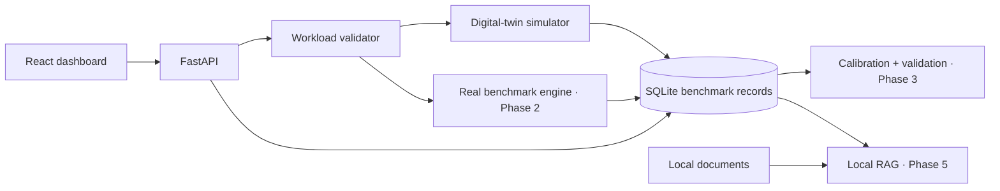

# TransformerTwin architecture

Phase 1 only enables `SIM`, using deterministic synthetic demonstration records. The database source column and dashboard distinguish `synthetic` from `measured`; the benchmark API intentionally returns 501 until actual local inference is implemented.
